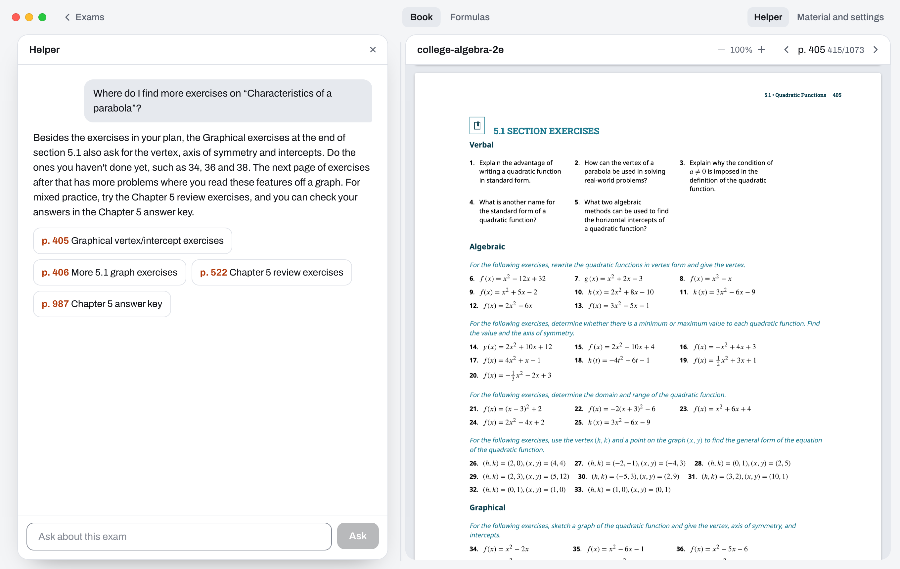

# Spurt

A study app for the Mac. You tell it which exam, when, how much time you have and which grade
you want. You give it your book and your learning objectives. It gives you one list: what to
read and which exercises from the book to solve, with page and number, in the book's order, and
what is left out when the time is short. You tick off, the percentage moves, and at the end an
exam on everything shows where you stand.


| Formula sheet | Helper | Final exam |
|---|---|---|
|  |  |  |

More pictures, light and dark: [`docs/shots`](docs/shots) ([all on one sheet](docs/shots/overview.png)).
The book in the pictures is OpenStax *College Algebra 2e* ([CC BY 4.0](https://creativecommons.org/licenses/by/4.0/),
[openstax.org](https://openstax.org/details/books/college-algebra-2e)); the plan, formulas and
answers around it were written by Claude Opus 5.5 through Claude Code in a real run.

## What it does

- **One screen per exam.** How much of the plan is done, as a large number. Under it the plan
  as one checklist, topic by topic: what you need to be able to do, then the steps ("Read
  p. 255–256", "Solve p. 257: 3, 4, 7"). The next step is marked, a line shows where today's
  share ends, finished topics fold away. A tick is a switch: click again to take it back.
- **The book beside the plan.** Your PDF opens inside the app, next to the list. A step jumps to
  its page. The divider can be dragged, the panel hidden.
- **Formula sheet.** The formulas this exam needs, large, grouped by topic, each with a link to
  the page it comes from. The topic you are on shows its own formulas right in the plan, so
  they are at hand while the panel shows the book. Written once with the strategy and kept.
- **Helper.** Ask anything about the exam or the book ("On which page do I find exercises for
  this?"). The pages for a question are found by a search on your Mac through the whole text of
  your books; only those go to the AI. Pages in an answer are links that move the book; the
  conversation stays open beside it.
- **Final exam.** When the list is done (or earlier, if you like): questions over all topics
  where you type **only the result**. Numbers are compared on your Mac, in any notation
  (`21920.70`, `21'920.70`, `CHF 21 920,70`, `x = 3`); nobody asks for the working. Results that
  are not numbers (an equation, an interval) are marked by the AI, which is told to look at the
  result only. Afterwards: the worked solutions, a grade estimate, and the topics that went
  badly back on your list, with exercises from the book you have not done yet.
- **Questions from the AI only where the book has none.** A topic without exercises in the book
  gets a few questions written from your material, and they are labelled as such.
- **New exam.** Five questions: which exam, when, how much time (per day or in total), the grade
  you aim for (Swiss 1 to 6, German 1 to 6, or percent) and a pace: *Sprint* (little time, only
  what brings the most points), *Thorough* (everything) or *Efficient* (the best grade for the
  least time).
- **Material.** Drop in the book as a PDF, paste the learning objectives, add slides, notes or
  old exams. A PDF without text in it (a scan, or a book saved with
  [Stapel](https://github.com/KorelUyar/stapel), which draws letters as shapes) is read with the
  text recognition built into macOS, on your Mac, and shows in the book panel like any other.

The interface is English or German; on a first start it follows your Mac. What the AI writes
follows the language of your material.

## Your data and the AI

Spurt has no server, no account, no telemetry and no update check. Exams, plans and results are
in one file in the app's folder on your Mac; your PDFs are copied next to it. Deleting an exam
also deletes its copies of the PDFs, the text read from them and the answers kept for it,
unless another exam uses them.

The AI is one you bring:

| | |
|---|---|
| **Claude Code on this Mac** | uses your own Claude Code login, no key. Settings shows whether you are signed in, and starts Claude Code's own sign-in when you are not |
| **Anthropic API key** | you pay Anthropic per use |
| **OpenRouter key** | one key for models from many providers |
| **Another server** | anything that speaks the OpenAI chat format, such as [Ollama](https://ollama.com) on your own computer |

What leaves your Mac, and where to:

- **To the provider you chose, and nowhere else:** the text of the pages a step needs, your
  learning objectives, the exam's name, date, time and target grade, your questions to the
  helper, and the results you type in an exam when they are not numbers. For a large book that
  is first the table of contents, to find the pages, then those pages. Never the PDF itself.
- **With "Claude Code on this Mac":** Spurt starts the `claude` command on your Mac with all its
  tools switched off, so it can only read the text it is given and answer.
- **With OpenRouter:** requests carry the app's name (`X-Title: Spurt`), and the price for the
  estimate comes from OpenRouter's public model list.
- **With "another server":** the address must start with `https://`; plain `http://` is only
  accepted for a server on your own computer. Its key is forgotten when you change the address.
- **Keys** are stored through the Mac's keychain and are used only in the app's main process,
  never in the window.

Before a large run you see an estimate of tokens and, where the price is known, cost, and how
long it usually takes. Every answer that could be used is kept on disk, so nothing is asked
twice; an answer that could not be used is never kept.

A real run on a 1073-page textbook, through Claude Code with Claude Opus 5.5: the strategy with
its formula sheet took about 58,000 tokens in and 8,000 out (64 seconds), a question to the
helper about 14,000 in (6 seconds), a final exam of twelve questions about 15,000 in and 5,000
out (44 seconds), and marking the results that were not numbers a few hundred (5 seconds). All
of it together: 89,000 tokens in and 13,000 out. With the same model on the Anthropic API that
is about 60 cents at list price, and less in practice: pages the provider has just seen are
billed at a fraction.

**How far each provider is tested.** Claude Code on this Mac has run the whole of 0.2 for real,
on a whole book: strategy and formula sheet, helper, final exam and marking. The Anthropic API
ran the whole path of 0.1 for real with each of its four models; the parts new in 0.2 are tested
against a stand-in that speaks its format, not against the real service. "Another server" has
run against a real Ollama with a small model in 0.1. OpenRouter is the least tested: against a
stand-in for its format, and the real service only as far as refusing a wrong key. If one of
them misbehaves for you, please [open an issue](https://github.com/KorelUyar/spurt/issues).

## What to know

- **Page and exercise numbers are checked.** After the model answers, Spurt looks for every
  exercise number on the page it was cited on, moves it if it is on a neighbouring page, and
  says so under the step when it cannot find it.
- **The grade after the final exam is an estimate.** The questions are written by the AI from
  your material, not by whoever sets your exam; the share of points per topic is the model's
  judgement from your objectives and old exams.
- **A formula on the sheet can be wrong.** It is written by the AI. Each one links to its page:
  check it against the book before you rely on it. Formulas in a PDF are often pictures, so
  the model sees the sentence around a formula but not always the formula itself.
- **Recognised text is not perfect.** Small print and formulas in a book without real text can
  come out wrong. The book panel always shows the real page.
- **A small model gives a weak plan.** With a small local model, expect vague topics and page
  references that do not hold. Spurt leaves out references to pages the model was not shown.
- **Your data file has a backup.** Every start that can read your exams keeps a copy. If the
  file is ever damaged, Spurt says so, overwrites nothing, and offers the copy.
- **After an update, macOS may ask once** whether Spurt may read its saved key from the
  keychain, because the app is not notarised.

## Install

macOS 13 or later, Apple Silicon or Intel:

```sh
curl --proto '=https' --tlsv1.2 -fsSL https://github.com/KorelUyar/spurt/releases/latest/download/install.sh | zsh
```

This downloads the latest version, puts it in Applications and opens it. Spurt is not notarised
by Apple (that needs a paid developer account). Installing it this way skips the "cannot be
opened" warning that macOS shows for apps downloaded with a browser. With a
`Spurt-macOS.zip` you downloaded yourself:

```sh
SPURT_ZIP=/path/to/Spurt-macOS.zip zsh install.sh
```

## Develop

Needs Node 22 and, for the text recognition helper, Xcode's command line tools.

```sh
npm install
npm run ocr      # builds the text recognition helper (native/ocr.swift)
npm start        # the app, on your real data
npm run sample   # the app on invented exams, nothing is saved
```

| | |
|---|---|
| `npm test` | planner, results in every notation, page search, store (damaged file, backup, a file from 0.1), reference check, the engine and every key-based provider against a local stand-in server |
| `npm run smoke` | clicks through the app in a hidden window: an empty start up to a final exam (with a real file drop), the sample exams, and a damaged data file |
| `npm run checks` | keyboard only, the wizard's edges, time in total, percent and German scale, reduced motion |
| `electron scripts/window-check.js` | opens a real window for a few seconds: traffic lights, minimum size, date field |
| `electron scripts/e2e.js <book.pdf> <objectives.txt> <outDir>` | the whole path for real through Claude Code (costs tokens) |
| `electron scripts/wrong-key.js` | asks the real Anthropic and OpenRouter services with a key that is not one |
| `scripts/fixtures/claude-stub.sh` | a stand-in for the `claude` command with prepared answers, so the tests can play every state (not signed in, expired, usage limit, offline, a slow run) without touching a real login |
| `npm run shots` | the pictures in `docs/shots` from the sample exams; with a data folder as third argument to `scripts/shots.js`, the ones with a real book |
| `npm run dist` | `dist/Spurt-macOS.zip`: universal, signed ad hoc |

Where things are:

- `main.js`, `preload.js`: the window and everything it may ask for.
- `src/engine.js`, `src/prompts.js`: from material to strategy, formula sheet, exam questions
  and answers to the helper.
- `src/planner.js`: the plan: what fits, in which order, today's share. No AI in it.
- `src/answers.js`: is a typed result right? Numbers in every notation, decided on the Mac.
- `src/search.js`: finds the pages of a book a question is about.
- `src/ai/`: the four providers behind one `ask()` that checks the answer against a schema.
- `src/files.js`, `src/pdf-worker.js`, `src/ocr.js`, `native/ocr.swift`: reading PDFs.
- `src/store.js`, `src/secrets.js`: what is kept, and the keys.
- `ui/`: the interface. Plain HTML, CSS and JavaScript modules, no bundler; Preact with htm,
  KaTeX, pdf.js and the Archivo typeface are vendored in `ui/vendor`. `ui/i18n.js` holds all
  text. `ui/path.js` is the exam screen, `ui/book.js` the book beside it, `ui/final.js` an exam
  being taken, `ui/setup.js` material and settings of an exam.
- The name "Spurt" comes from `productName` in `package.json`.

## Licence

MIT. See `LICENSE`. Third-party files and their licences: `ui/vendor/README.txt`.
