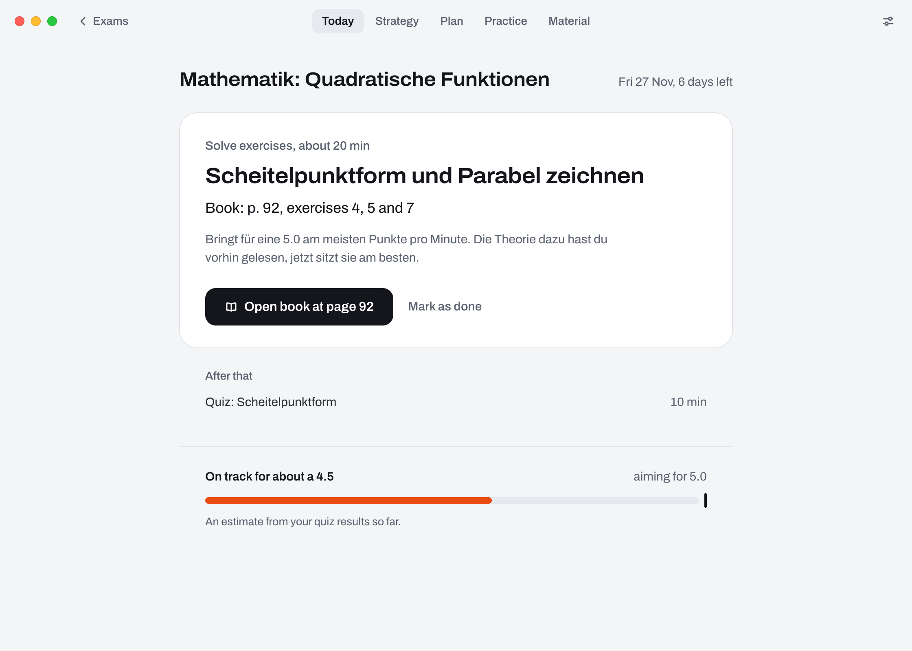
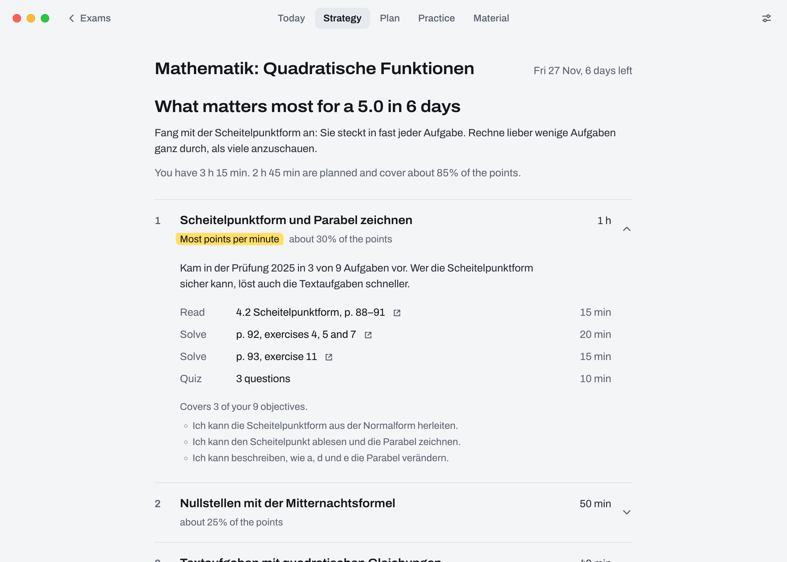

# Spurt

A study app for the Mac. You tell it which exam, when, how much time you have and which grade
you want. You give it your book and your learning objectives. It tells you what matters most,
which pages to read and which exercises from the book to solve, plans your days, quizzes you
and corrects your answers.



| Strategy | Quiz |
|---|---|
|  |  |

More pictures, light and dark, English and German: [`docs/shots`](docs/shots) ([all on one sheet](docs/shots/overview.png)).

## What it does

- **Home.** Your exams, with the days left and how ready you are.
- **New exam.** Five questions: which exam, when, how much time (per day or in total), the grade
  you aim for (Swiss 1 to 6, German 1 to 6, or percent) and a pace: *Sprint* (little time, only
  what brings the most points), *Thorough* (everything, with repetition) or *Efficient* (the best
  grade for the least time).
- **Material.** Drop in the book as a PDF, paste the learning objectives, add slides, notes or
  old exams. A PDF without text in it (a scan, or a book saved with
  [Stapel](https://github.com/KorelUyar/stapel), which draws letters as shapes) is read with the
  text recognition built into macOS, on your Mac.
- **Strategy.** The topics of the exam ranked by points per minute, each with the pages to read
  and the exercises to solve (page and number), with time estimates. If the time is too short,
  it says what is left out and what that costs.
- **Plan.** Day by day, within the minutes you have. It re-forms when you fall behind, do more,
  or a quiz shows a weak topic.
- **Practice.** Quizzes per topic and a mock exam: multiple choice, short and open answers,
  corrected with a short reason and the page in the book. Missed questions come back after
  1, 2, 4 and 7 days, mixed across topics.
- **The book at the page.** Every page reference opens the PDF there, in its own window.

The interface is English or German. What the AI writes follows the language of your material.

## Your data and the AI

Spurt has no server, no account, no telemetry and no update check. Exams, plans and results are
in one file in the app's folder on your Mac; your PDFs are copied next to it. Deleting an exam
also deletes its copies of the PDFs, the text read from them and the answers kept for it,
unless another exam uses them.

The AI is one you bring:

| | |
|---|---|
| **Claude Code on this Mac** | uses your own Claude Code login, no key. Settings shows whether you are signed in, and starts Claude Code's own sign-in when you are not |
| **Anthropic API key** | you pay Anthropic per use |
| **OpenRouter key** | one key for models from many providers |
| **Another server** | anything that speaks the OpenAI chat format, such as [Ollama](https://ollama.com) on your own computer |

What leaves your Mac, and where to:

- **To the provider you chose, and nowhere else:** the text of the pages a step needs, your
  learning objectives, the exam's name, date, time and target grade, and your quiz answers when
  they are corrected. For a large book that is first the table of contents, to find the pages,
  then those pages. Never the PDF itself.
- **With "Claude Code on this Mac":** Spurt starts the `claude` command on your Mac with all its
  tools switched off, so it can only read the text it is given and answer.
- **With OpenRouter:** requests carry the app's name (`X-Title: Spurt`), and the price for the
  estimate comes from OpenRouter's public model list.
- **With "another server":** the address must start with `https://`; plain `http://` is only
  accepted for a server on your own computer. Its key is forgotten when you change the address.
- **Keys** are stored through the Mac's keychain and are used only in the app's main process,
  never in the window.

Before a large run you see an estimate of tokens and, where the price is known, cost. Every
answer is kept on disk, so nothing is asked twice.

Real runs on a 1073-page textbook: finding the pages and working out the strategy took 17,000
to 31,000 tokens in and about 3,000 out (13 to 19 cents with Claude Opus 5.5 on the Anthropic
API). With a quiz, a mock exam and their corrections, the whole exam came to about 54,000
tokens in and 11,000 out, about 45 cents. Asking again about the same pages is cheaper:
Anthropic bills pages it has just seen at about a tenth.

**How far each provider is tested.** Claude Code on this Mac and the Anthropic API have both
run the whole path for real, on whole books: strategy, quizzes, corrections and a mock exam; on
the Anthropic API each of the four models offered has answered. "Another server" has run
against a real Ollama with a small model. OpenRouter is the least tested: against a stand-in
for its format, and the real service only as far as refusing a wrong key. If one of them
misbehaves for you, please [open an issue](https://github.com/KorelUyar/spurt/issues).

## What to know

- **Page and exercise numbers are checked.** After the model answers, Spurt looks for every
  exercise number on the page it was cited on, moves it if it is on a neighbouring page, and
  marks it when it cannot find it. The Strategy view says how many were found.
- **Estimates are estimates.** The projected grade assumes you finish the plan and follows your
  quiz results; the share of points per topic is the model's judgement from your objectives and
  old exams.
- **Formulas in a PDF are often pictures.** Their text does not come out of the file, so the
  model sees the sentence around a formula but not always the formula. Quizzes and corrections
  write their own formulas (drawn with KaTeX).
- **Recognised text is not perfect.** Small print and formulas in a book without real text can
  come out wrong.
- **A small model gives a weak plan.** With a small local model, expect vague topics and page
  references that do not hold. Spurt leaves out references to pages the model was not shown and
  says how many.
- **After an update, macOS may ask once** whether Spurt may read its saved key from the
  keychain, because the app is not notarised.

## Install

macOS 13 or later, Apple Silicon or Intel:

```sh
curl --proto '=https' --tlsv1.2 -fsSL https://github.com/KorelUyar/spurt/releases/latest/download/install.sh | zsh
```

This downloads the latest version, puts it in Applications and opens it. Spurt is not notarised
by Apple (that needs a paid developer account). Installing it this way skips the "cannot be
opened" warning that macOS shows for apps downloaded with a browser. With a
`Spurt-macOS.zip` you downloaded yourself:

```sh
SPURT_ZIP=/path/to/Spurt-macOS.zip zsh install.sh
```

## Develop

Needs Node 22 and, for the text recognition helper, Xcode's command line tools.

```sh
npm install
npm run ocr      # builds the text recognition helper (native/ocr.swift)
npm start        # the app, on your real data
npm run sample   # the app on invented exams, nothing is saved
```

| | |
|---|---|
| `npm test` | planner, reference check, and every key-based provider against a local stand-in server |
| `npm run smoke` | clicks through the app in a hidden window: empty start, and the sample exams |
| `npm run checks` | keyboard only, time in total, percent and German scale, reduced motion |
| `electron scripts/window-check.js` | opens a real window for a few seconds: traffic lights, minimum size, date field |
| `electron scripts/e2e.js <book.pdf> <objectives.txt> <outDir>` | the whole path for real through Claude Code (costs tokens) |
| `electron scripts/wrong-key.js` | asks the real Anthropic and OpenRouter services with a key that is not one |
| `scripts/fixtures/claude-stub.sh` | a stand-in for the `claude` command, so the tests can play "not signed in" and "expired" without touching a real login |
| `npm run shots` | the pictures in `docs/shots` |
| `npm run dist` | `dist/Spurt-macOS.zip`: universal, signed ad hoc |

Where things are:

- `main.js`, `preload.js`: the window and everything it may ask for.
- `src/engine.js`, `src/prompts.js`: from material to strategy, quizzes and corrections.
- `src/planner.js`: the plan, spaced repetition and the grade projection. No AI in it.
- `src/ai/`: the four providers behind one `ask()` that checks the answer against a schema.
- `src/files.js`, `src/pdf-worker.js`, `src/ocr.js`, `native/ocr.swift`: reading PDFs.
- `src/store.js`, `src/secrets.js`: what is kept, and the keys.
- `ui/`: the interface. Plain HTML, CSS and JavaScript modules, no bundler; Preact with htm,
  KaTeX and the Archivo typeface are vendored in `ui/vendor`. `ui/i18n.js` holds all text.
- The name "Spurt" comes from `productName` in `package.json`.

## Licence

MIT. See `LICENSE`. Third-party files and their licences: `ui/vendor/README.txt`.
