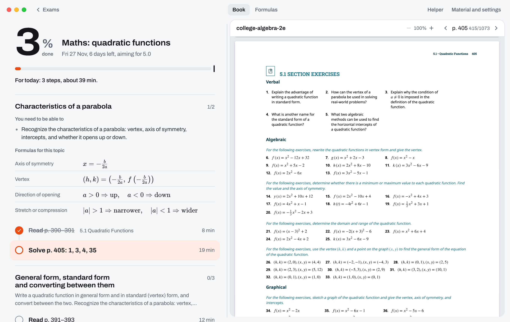
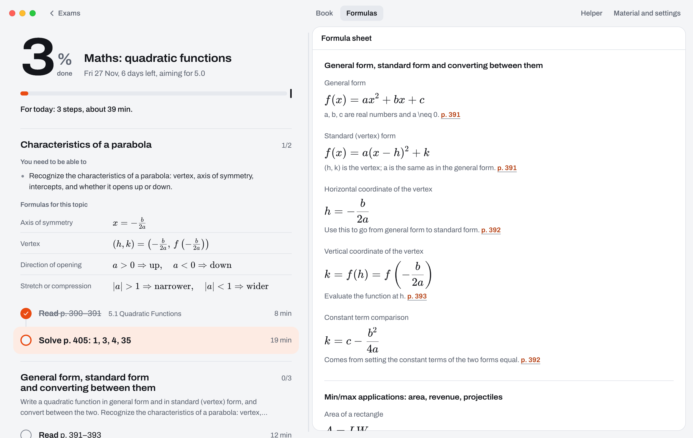
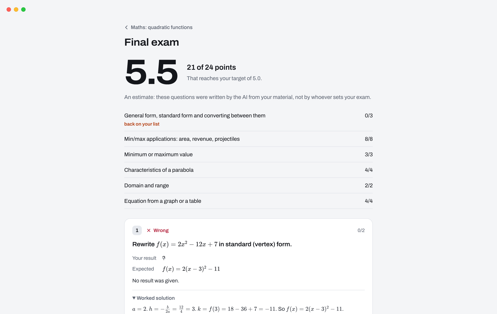
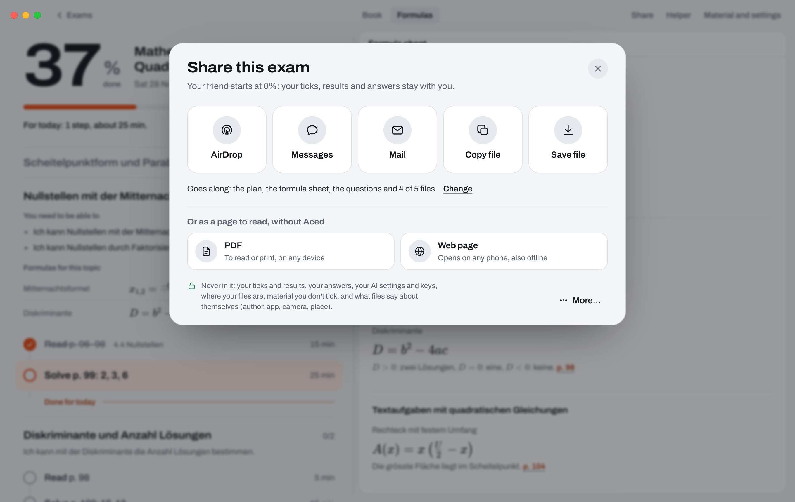
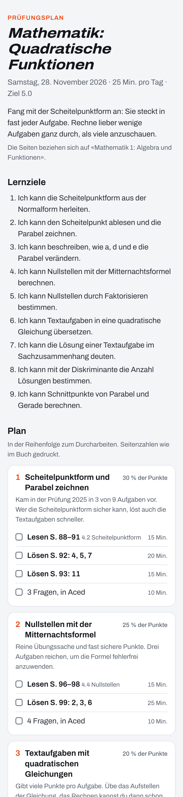
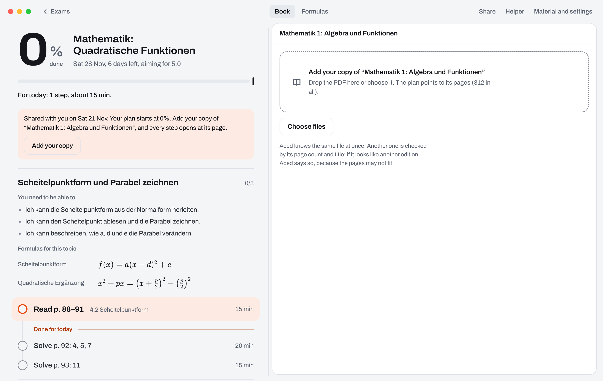

# Aced

**Aced: know exactly what to do before your exam.**

A study app for the Mac. You tell it which exam, when, how much time you have and which grade
you want. You give it your book and your learning objectives. It gives you one list: what to
read and which exercises from the book to solve, with page and number, in the book's order, and
what is left out when the time is short. You tick off, the percentage moves, and at the end an
exam on everything shows where you stand.



| Formula sheet | Helper | Final exam |
|---|---|---|
|  |  |  |

| Share | The web page on a phone | A friend opens it |
|---|---|---|
|  |  |  |

More pictures, light and dark: [`docs/shots`](docs/shots) ([all on one sheet](docs/shots/overview.png)).
The book in the pictures is OpenStax *College Algebra 2e* ([CC BY 4.0](https://creativecommons.org/licenses/by/4.0/),
[openstax.org](https://openstax.org/details/books/college-algebra-2e)); the plan, formulas and
answers around it were written by Claude Opus 5.5 through Claude Code in a real run.

## What it does

- **One screen per exam.** How much of the plan is done, as a large number. Under it the plan
  as one checklist, topic by topic: what you need to be able to do, then the steps ("Read
  p. 255–256", "Solve p. 257: 3, 4, 7"). The next step is marked, a line shows where you are
  done for today, finished topics fold away. A tick is a switch: click again to take it back.
- **The book beside the plan.** Your book opens inside the app, next to the list. A step jumps to
  its page. The divider can be dragged, the panel hidden. You can write in it: pen,
  highlighter, text notes, eraser and undo, kept per page on your Mac, never in the PDF and
  never shared.
- **Formula sheet.** The formulas this exam needs, large, grouped by topic, each with a link to
  the page it comes from. The topic you are on shows its own formulas right in the plan, so
  they are at hand while the panel shows the book. Written once with the strategy and kept.
- **Helper.** Ask anything about the exam or the book ("On which page do I find exercises for
  this?"). The pages for a question are found by a search on your Mac through the whole text of
  your books; only those go to the AI. Pages in an answer are links that move the book; the
  conversation stays open beside it.
- **Final exam.** When the list is done (or earlier, if you like): questions over all topics
  where you type **only the result**. Numbers are compared on your Mac, in any notation
  (`21920.70`, `21'920.70`, `CHF 21 920,70`, `x = 3`); nobody asks for the working. Results that
  are not numbers (an equation, an interval) are marked by the AI, which is told to look at the
  result only. Afterwards: the worked solutions, a grade estimate, and the topics that went
  badly back on your list, with exercises from the book you have not done yet.
- **Questions from the AI only where the book has none.** A topic without exercises in the book
  gets a few questions written from your material, and they are labelled as such.
- **Share an exam with friends.** One button on the exam screen opens Aced's own share window,
  where every way is one click. Five ways send the exam as an **Aced file** that opens in your
  friend's Aced (a double-click is enough): **AirDrop**, **Messages** and **Mail** open with
  the file attached, **Copy file** puts it on the clipboard to paste into WhatsApp, Messages or
  Mail, and **Save file** saves it (in Downloads, unless you choose another place). Below them,
  the exam as a page to read without Aced: a **PDF** to read or print, or a **web page** that
  opens on any phone or computer, also offline. The Mac's own share menu comes last ("More…").
  If AirDrop, Messages or Mail is not set up on your Mac, the window says so. **Copy link**
  appears only in an Aced that has a share service: then it comes first, and your friend opens
  the exam from a link (see "What leaves your Mac"); without one, the window has no link. Your
  friend starts at 0%: your ticks, results and answers stay with you. You tick what goes along
  ("Change" in the window): your own notes,
  worksheets and screenshots, each with the text your Aced (or your AI) read from it, so
  opening the file reads nothing again and costs nothing. What you don't tick stays home
  entirely. Books stay out by default (they are big, and your friend should use their own
  copy): of a book, only its title, page count and a fingerprint go along. When your friend
  adds their copy, Aced knows the same file by its SHA-256 at once; another file is compared by
  the text of three of its pages (by their sizes when there is no text), and Aced says when it
  looks like another edition. The same file opened twice asks: open the exam you have, or add
  another copy.
- **New exam.** Five questions: which exam, when, how much time (per day or in total), the grade
  you aim for (Swiss 1 to 6, German 1 to 6, or percent) and a pace: *Sprint* (little time, only
  what brings the most points), *Thorough* (everything) or *Efficient* (the best grade for the
  least time).
- **Material in any format.** Drop in the book, paste the learning objectives, add slides,
  notes or old exams: PDFs, screenshots and photos (PNG, JPEG, HEIC, GIF, TIFF, BMP, WebP), Word
  (docx, doc, rtf, odt), Excel (xlsx, xls, csv, ods), PowerPoint (pptx, ppt, odp), Pages,
  Numbers and Keynote, web pages, SVG drawings, e-books (EPUB), Jupyter notebooks, and text of
  any kind (Markdown, LaTeX, JSON, source code). Drop a whole folder, or copy a screenshot
  (⌃⇧⌘4) or files in the Finder and paste them with ⌘V. Every file becomes a page in the book
  panel like a PDF, and steps, page links, the helper and the formula sheet work the same.
- **Your AI reads your pictures.** Screenshots, photos and short scans (up to 20 pages) are read
  at once by the text recognition built into macOS, on your Mac, and right after by the AI you
  chose, which writes down what is on each page with its formulas in LaTeX. Several pictures
  added together are one document, in the order they were taken. When your AI cannot see
  pictures, or cannot be reached, the text read on your Mac stays, and the material says so. A
  long scanned book stays with the recognition on your Mac; a book saved with
  [Stapel](https://github.com/KorelUyar/stapel), which draws letters as shapes, is read the same
  way.

The interface is English or German; on a first start it follows your Mac. What the AI writes
follows the language of your material.

## Your data and the AI

Aced has no server, no account, no telemetry and no update check. Exams, plans and results are
in one file in the app's folder on your Mac; your files are copied next to it, each with the PDF
made from it. Deleting an exam also deletes its copies, the text read from them and the answers
kept for it, unless another exam uses them.

The AI is one you bring:

| | |
|---|---|
| **Claude Code on this Mac** | uses your own Claude Code login, no key. Settings shows whether you are signed in, and starts Claude Code's own sign-in when you are not |
| **Anthropic API key** | you pay Anthropic per use |
| **OpenRouter key** | one key for models from many providers |
| **Another server** | anything that speaks the OpenAI chat format, such as [Ollama](https://ollama.com) on your own computer |

What leaves your Mac, and where to:

- **To the provider you chose, and nowhere else:** the text of the pages a step needs, your
  learning objectives, the exam's name, date, time and target grade, your questions to the
  helper, and the results you type in an exam when they are not numbers. For a large book that
  is first the table of contents, to find the pages, then those pages. Never a PDF, Word file or
  book itself. **Pictures:** a picture of each page of material that is only pictures
  (screenshots, photos, scans of up to 20 pages), once, when you add it, so your AI can read it.
  With "another server", a small picture with two numbers on it goes there once, to find out
  whether its model can see.
- **With "Claude Code on this Mac":** Aced starts the `claude` command on your Mac with all its
  tools switched off, so it can only read the text and the pictures it is given and answer. It
  starts it with none of your settings files (`--setting-sources ""`), so your hooks, plugins,
  MCP servers, skills and `CLAUDE.md` files are not part of a request that carries your pages;
  Claude Code's own built-in parts run as usual. It uses the login Claude Code keeps itself (the
  claude.ai sign-in, or a key in your shell's environment). A login that works only through
  your settings (an `apiKeyHelper`) is not used: Aced then says to sign in.
- **With OpenRouter:** requests carry the app's name (`X-Title: Aced`), and the price for the
  estimate comes from OpenRouter's public model list.
- **With "another server":** the address must start with `https://`; plain `http://` is only
  accepted for a server on your own computer. Its key is forgotten when you change the address.
- **Keys** are stored through the Mac's keychain and are used only in the app's main process,
  never in the window.
- **With "Copy link":** Aced makes links only when it has a share service (an Aced without one
  has no "Copy link", and nothing goes anywhere). Then the Aced file you share is locked on your
  Mac with a key made for that one link (AES-256-GCM), and only the locked bytes go to that
  service, which keeps them for 30 days and cannot read them: the key is only in the link,
  after `#`, the part of an address that browsers never send to a server. Whoever has the link
  can open the exam. A link that is opened is fetched from that service and nowhere else.

Before a large run you see an estimate of tokens and, where the price is known, cost, and how
long it usually takes. Reading pictures is not asked first: a page costs about 3,000 tokens in
(a few cents with a key), and the material says afterwards who read it and, with a key, what it
cost. Every answer that could be used is kept on disk, so nothing is asked twice; an answer
that could not be used is never kept.

A real run on a 1073-page textbook, through Claude Code with Claude Opus 5.5: the strategy with
its formula sheet took about 58,000 tokens in and 8,000 out (64 seconds), a question to the
helper about 14,000 in (6 seconds), a final exam of twelve questions about 15,000 in and 5,000
out (44 seconds), and marking the results that were not numbers a few hundred (5 seconds). All
of it together: 89,000 tokens in and 13,000 out. With the same model on the Anthropic API that
is about 60 cents at list price, and less in practice: pages the provider has just seen are
billed at a fraction.

**How far each provider is tested.** Claude Code on this Mac has run the whole of 0.2 for real,
on a whole book: strategy and formula sheet, helper, final exam and marking. The Anthropic API
ran the whole path of 0.1 for real with each of its four models; the parts new in 0.2 are tested
against a stand-in that speaks its format, not against the real service. "Another server" has
run against a real Ollama with a small model in 0.1. OpenRouter is the least tested: against a
stand-in for its format, and the real service only as far as refusing a wrong key. Reading pictures (new in 0.4) has run for real through Claude Code, on screenshots of an
exercise sheet with formulas; with the Anthropic API, OpenRouter and other servers it is tested
against stand-ins for their formats. If one of
them misbehaves for you, please [open an issue](https://github.com/KorelUyar/aced/issues).

## What to know

- **Page and exercise numbers are checked.** After the model answers, Aced looks for every
  exercise number on the page it was cited on, moves it if it is on a neighbouring page, and
  says so under the step when it cannot find it.
- **The grade after the final exam is an estimate.** The questions are written by the AI from
  your material, not by whoever sets your exam; the part of the points each topic is worth is the model's
  judgement from your objectives and old exams.
- **A formula on the sheet can be wrong.** It is written by the AI. Each one links to its page:
  check it against the book before you rely on it. Formulas in a PDF are often pictures, so
  the model sees the sentence around a formula but not always the formula itself.
- **Recognised text is not perfect.** The recognition on your Mac reads print well and formulas
  badly: in a screenshot, `x² − 7x + 12 = 0` comes out as "x - 7x + 12 = 0" and a fraction as
  its parts. That is why your AI reads pictures right after. Small print in a long scanned book,
  which stays with the recognition on your Mac, can come out wrong. The book panel always shows
  the real page.
- **How other files come through.** Aced makes a PDF of every file and keeps the original next
  to it. Word formulas (Word's own format, and OpenDocument's) are drawn as formulas and reach
  the AI as LaTeX. A spreadsheet is printed sheet by sheet with its columns lettered and its rows
  numbered, as the cells show their values; of each sheet, the first 1000 rows and 40 columns,
  and Aced says when it cut. Old PowerPoint files are read through macOS's Quick Look, old Word
  files and RTF through macOS's textutil. Pages, Numbers and Keynote files keep only a picture
  of their first page and their text where other apps can read them: Aced reads those and says
  so; for all of it, export a PDF from the app. Web pages, drawings and e-books are drawn with
  scripts off and nothing loaded from the internet; a saved web page takes in only the pictures
  right next to it and in its own `_files` folder. Sheets hidden in a workbook are left out and
  named on the material, and a part of a Word file kept in another format (an embedded RTF, say)
  is left out with a note. A file that cannot be read gets a sentence that says what to do
  instead.
- **A shared Aced file is checked like any file from outside.** It is a zip with the plan as
  JSON and the material as PDFs, read with the same limits as an Office file; every field is
  checked and cut to size, nothing in it may name a place on your Mac, the text that comes along
  is used only when it fits its PDF page for page, ids that every JavaScript object has
  (`constructor`, `__proto__` …) are refused, and a damaged file or one from a newer Aced gets a
  sentence instead of an exam. Opening one asks no AI. A link is checked the same way: Aced takes
  only links of its own form, fetches only from its own share service whatever the link says,
  and opens only what unlocks with the link's key, then like a file. What never goes into an
  Aced file, a link, a PDF or a web page: your ticks, results and answers, your AI settings and
  keys, what you wrote in the book, where your files are (no folders, no paths), material you
  did not tick, and anything about your Mac or your account. Material you tick goes along with
  its title (its file name, unless you renamed it).
  Every PDF in an Aced file is a clean copy, drawn anew: without the document's information
  (author, title, the app that made it), its XMP metadata, attachments and links, and with what
  its photos say about themselves (camera, owner, place, time) blanked. The PDF and the web
  page carry a small "Made with Aced · uyarid.com" line.
- **Links are never followed.** A symbolic link in a dropped folder (an unpacked archive can
  hold one pointing at any file on your Mac), dropped on its own, or inside a Pages or RTF
  package is not read: Aced says it is only a link. A link dragged in or pasted (a bookmark,
  "Copy Link", a `file://` address in text) is not opened either; only files themselves count,
  dragged in or copied in the Finder.
- **A small model gives a weak plan.** With a small local model, expect vague topics and page
  references that do not hold. Aced leaves out references to pages the model was not shown.
- **The book is only a picture.** A PDF is untrusted: in the panel nothing in it can be clicked,
  no script in it runs, and it cannot open a window or leave the app. The page that shows it
  has a strict content policy. The part of pdf.js that decodes the file runs as a worker beside
  that page, and a worker loaded from the app's own files is not under that policy. pdf.js is
  told never to evaluate anything from a PDF, and keys never reach the window or the worker.
- **The first book without text after an install or update takes a minute longer.** macOS
  prepares its text recognition once; Aced starts that in the background when it opens and
  says so if you are faster.
- **Your data file has a backup.** Every start that can read your exams keeps a copy. If the
  file is ever damaged, Aced says so, overwrites nothing, and offers the copy.
- **After an update, macOS may ask once** whether Aced may read its saved key from the
  keychain, because the app is not notarised.

## Install

macOS 13 or later, Apple Silicon or Intel:

```sh
curl --proto '=https' --tlsv1.2 -fsSL https://github.com/KorelUyar/aced/releases/latest/download/install.sh | zsh
```

This downloads the latest version, puts it in Applications and opens it. Aced is not notarised
by Apple (that needs a paid developer account). Installing it this way skips the "cannot be
opened" warning that macOS shows for apps downloaded with a browser. With a
`Aced-macOS.zip` you downloaded yourself:

```sh
ACED_ZIP=/path/to/Aced-macOS.zip zsh install.sh
```

### Coming from Spurt

Aced was called Spurt up to version 0.2. The install line above replaces Spurt with Aced (the
old line still works and does the same). When Aced first starts, it moves what you had in
Spurt into its own place: exams, ticks, books and backups. One thing cannot come along: a saved
API key. macOS keeps it locked under the old app's name, so Aced asks you to enter it once
more. With Claude Code there is nothing to enter.

## Develop

Needs Node 22 and, for the text recognition helper, Xcode's command line tools. Nothing else:
every format is read by Aced itself or by what comes with macOS.

```sh
npm install
npm run ocr      # builds the text recognition helper (native/ocr.swift)
npm start        # the app, on your real data
npm run sample   # the app on invented exams, nothing is saved
```

| | |
|---|---|
| `npm test` | planner, results in every notation, page search, store (damaged file, backup, a file from 0.1), reference check, the engine and every key-based provider (pictures included) against a local stand-in server; every file format, made on this Mac, with the hostile kind (a zip bomb, an external entity, scripts and pictures from a server, a picture of 400 megapixels); and sharing: the sample exam sent from one fresh profile and opened in another, and hostile Aced files; links: locking and unlocking, hostile and broken links, the share service's limits and its 30 days, run against a service on this Mac; and what is written in a book, kept and checked |
| `npm run smoke` | clicks through the app in a hidden window: an empty start up to a final exam (with a real file drop), the sample exams, a damaged data file, material handed over without the Finder (a folder, ⌘V of a screenshot, of files and of text, picture data from a browser), and sharing (the share window's Save file, PDF and web page, an Aced file opened from the Finder, its book added); then the share window without and with a share service, AirDrop, Messages, Mail and Copy file (with the Mac's part stood in for), a link made against a service on this Mac and opened by a friend, hostile and run-out links, and writing in the book with the mouse (zoom, undo, eraser, notes) |
| `npm run checks` | keyboard only, the wizard's edges, time in total, percent and German scale, reduced motion |
| `electron scripts/window-check.js` | opens a real window for a few seconds: traffic lights, minimum size, date field |
| `electron scripts/e2e.js <book.pdf> <objectives.txt> <outDir>` | the whole path for real through Claude Code (costs tokens) |
| `electron scripts/e2e-formats.js <outDir>` | the same for screenshots, a Word file with formulas and an Excel file: read, planned, the book at the right page, found by the helper (costs tokens) |
| `electron scripts/wrong-key.js` | asks the real Anthropic and OpenRouter services with a key that is not one |
| `scripts/fixtures/claude-stub.sh` | a stand-in for the `claude` command with prepared answers, so the tests can play every state (not signed in, expired, usage limit, offline, a slow run) without touching a real login |
| `node service/server.js` | the share service behind links, on this Mac (its settings are in its first lines; `service/Dockerfile` and `service/aced-share.service` run it on a server). `ACED_LINK_HOST=http://127.0.0.1:8790 npm start` points a run from the source folder at it |
| `npm run shots` | the pictures in `docs/shots` from the sample exams; with a data folder as third argument to `scripts/shots.js`, the ones with a real book |
| `npm run dist` | `dist/Aced-macOS.zip`: universal, signed ad hoc |

Where things are:

- `main.js`, `preload.js`: the window and everything it may ask for.
- `src/engine.js`, `src/prompts.js`: from material to strategy, formula sheet, exam questions
  and answers to the helper.
- `src/planner.js`: the plan: what fits, in which order, what is for today. No AI in it.
- `src/answers.js`: is a typed result right? Numbers in every notation, decided on the Mac.
- `src/search.js`: finds the pages of a book a question is about.
- `src/ai/`: the four providers behind one `ask()` that checks the answer against a schema.
- `src/files.js`, `src/pdf-worker.js`, `src/ocr.js`, `native/ocr.swift`: the library, and reading
  PDFs. The Swift helper also puts pictures on PDF pages, makes pictures of pages for the AI, and
  hands files to AirDrop, Messages, Mail and the clipboard.
- `src/convert.js`, `src/convert-worker.js`, `src/formats/`, `src/print.js`: every other format to
  a PDF (the readers run in a process of their own; pages are printed with scripts off).
- `src/see.js`: the AI reading pictures.
- `src/share.js`, `src/export.js`, `ui/share.js`: sharing: the Aced file (written and read),
  the exam as one page (the PDF and the web page), and the share window.
- `src/mac-share.js`: AirDrop, Messages, Mail and the clipboard, through the Swift helper.
- `src/link.js`, `service/`: links: the Aced file locked on the Mac, and the small service that
  keeps it for 30 days and serves the page a link opens. The service's address is `HOST` in
  `src/link.js`; empty, there are no links.
- `ui/ink.js`, `src/ink.js`: writing in the book, and where it is kept.
- `src/store.js`, `src/secrets.js`: what is kept, and the keys.
- `ui/`: the interface. Plain HTML, CSS and JavaScript modules, no bundler; Preact with htm,
  KaTeX, pdf.js and the Archivo typeface are vendored in `ui/vendor`. `ui/i18n.js` holds all
  text. `ui/path.js` is the exam screen, `ui/book.js` the book beside it, `ui/final.js` an exam
  being taken, `ui/setup.js` material and settings of an exam.
- The name "Aced" comes from `productName` in `package.json`.

## Licence

MIT. See `LICENSE`. Third-party files and their licences: `ui/vendor/README.txt`.
