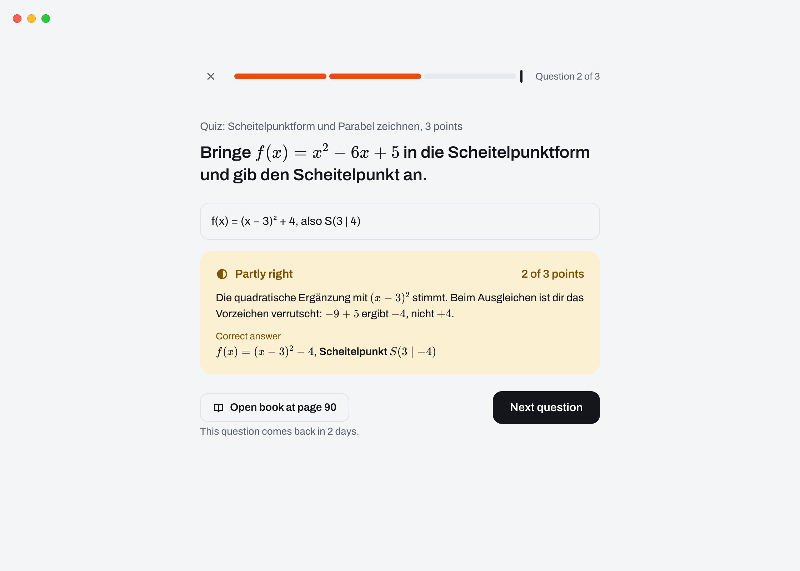

# Spurt

A study app for the Mac. You tell it which exam, when, how much time you have and which grade
you want. You give it your book and your learning objectives. It tells you what matters most,
which pages to read and which exercises from the book to solve, plans your days, quizzes you
and corrects your answers.


| Strategy | Quiz |
|---|---|
|  |  |

More pictures, light and dark, English and German: [`docs/shots`](docs/shots) ([all on one sheet](docs/shots/overview.png)).

## What it does

- **Home.** Your exams, with the days left and how ready you are.
- **New exam.** Five questions: which exam, when, how much time (per day or in total), the grade
  you aim for (Swiss 1 to 6, German 1 to 6, or percent) and a pace: *Sprint* (little time, only
  what brings the most points), *Thorough* (everything, with repetition) or *Efficient* (the best
  grade for the least time).
- **Material.** Drop in the book as a PDF, paste the learning objectives, add slides, notes or
  old exams. A PDF without text in it (a scan, or a book saved with
  [Stapel](https://github.com/KorelUyar/stapel), which draws letters as shapes) is read with the
  text recognition built into macOS, on your Mac.
- **Strategy.** The topics of the exam ranked by points per minute, each with the pages to read
  and the exercises to solve (page and number), with time estimates. If the time is too short,
  it says what is left out and what that costs.
- **Plan.** Day by day, within the minutes you have. It re-forms when you fall behind, do more,
  or a quiz shows a weak topic.
- **Practice.** Quizzes per topic and a mock exam: multiple choice, short and open answers,
  corrected with a short reason and the page in the book. Missed questions come back after
  1, 2, 4 and 7 days, mixed across topics.
- **The book at the page.** Every page reference opens the PDF there, in its own window.

The interface is English or German. What the AI writes follows the language of your material.

## Your data and the AI

Spurt has no server, no account and no telemetry. Exams, plans and results are in one file in
the app's folder on your Mac; your PDFs are copied next to it.

The AI is one you bring:

| | |
|---|---|
| **Claude Code on this Mac** | uses your own Claude Code login, no key |
| **Anthropic API key** | you pay Anthropic per use |
| **OpenRouter key** | one key for models from many providers |
| **Another server** | anything that speaks the OpenAI chat format, such as a model on your own computer |

Keys are stored through the Mac's keychain and never leave the main process. Your material goes
only to the provider you chose, and only the part a step needs: for a large book, first the
table of contents to find the pages, then those pages. Before a large run you see an estimate of
tokens and, where the price is known, cost. Every answer is kept on disk, so nothing is asked
twice. Claude Code runs with all its tools switched off.

A real run on a 1073-page textbook (finding the pages, the strategy, one quiz and its
corrections) used about 43,000 tokens in and 8,000 out.

## What to know

- **Page and exercise numbers are checked.** After the model answers, Spurt looks for every
  exercise number on the page it was cited on, moves it if it is on a neighbouring page, and
  marks it when it cannot find it. The Strategy view says how many were found.
- **Estimates are estimates.** The projected grade assumes you finish the plan and follows your
  quiz results; the share of points per topic is the model's judgement from your objectives and
  old exams.
- **Formulas in a PDF are often pictures.** Their text does not come out of the file, so the
  model sees the sentence around a formula but not always the formula. Quizzes and corrections
  write their own formulas (drawn with KaTeX).
- **Recognised text is not perfect.** Small print and formulas in a book without real text can
  come out wrong.

## Install

Spurt is not notarised by Apple (that needs a paid developer account), so a copy downloaded
with a browser is blocked by macOS at first. `scripts/install.sh` installs it without that
warning:

```sh
SPURT_ZIP=/path/to/Spurt-macOS.zip zsh scripts/install.sh
```

It puts `Spurt.app` into `/Applications` (or `~/Applications`) and opens it. macOS 13 or newer,
Apple Silicon or Intel.

## Develop

Needs Node 22 and, for the text recognition helper, Xcode's command line tools.

```sh
npm install
npm run ocr      # builds the text recognition helper (native/ocr.swift)
npm start        # the app, on your real data
npm run sample   # the app on invented exams, nothing is saved
```

| | |
|---|---|
| `npm test` | planner, reference check, and every key-based provider against a local stand-in server |
| `npm run smoke` | clicks through the app in a hidden window: empty start, and the sample exams |
| `npm run checks` | keyboard only, time in total, percent and German scale, reduced motion |
| `electron scripts/window-check.js` | opens a real window for a few seconds: traffic lights, minimum size, date field |
| `electron scripts/e2e.js <book.pdf> <objectives.txt> <outDir>` | the whole path for real through Claude Code (costs tokens) |
| `npm run shots` | the pictures in `docs/shots` |
| `npm run dist` | `dist/Spurt-macOS.zip`: universal, signed ad hoc |

Where things are:

- `main.js`, `preload.js`: the window and everything it may ask for.
- `src/engine.js`, `src/prompts.js`: from material to strategy, quizzes and corrections.
- `src/planner.js`: the plan, spaced repetition and the grade projection. No AI in it.
- `src/ai/`: the four providers behind one `ask()` that checks the answer against a schema.
- `src/files.js`, `src/pdf-worker.js`, `src/ocr.js`, `native/ocr.swift`: reading PDFs.
- `src/store.js`, `src/secrets.js`: what is kept, and the keys.
- `ui/`: the interface. Plain HTML, CSS and JavaScript modules, no bundler; Preact with htm,
  KaTeX and the Archivo typeface are vendored in `ui/vendor`. `ui/i18n.js` holds all text.
- The name "Spurt" comes from `productName` in `package.json`.

## Licence

MIT. See `LICENSE`. Third-party files and their licences: `ui/vendor/README.txt`.
